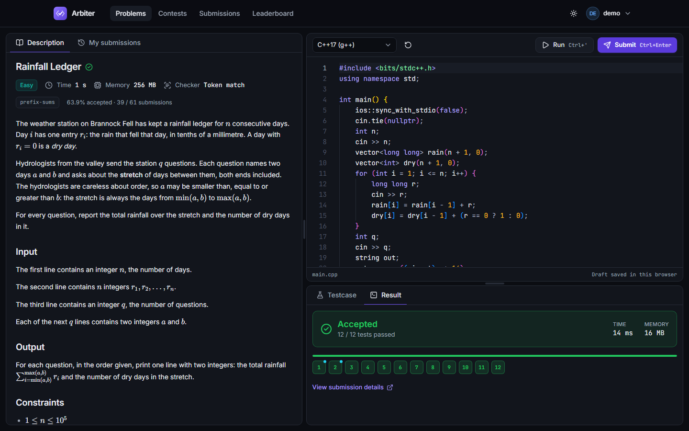
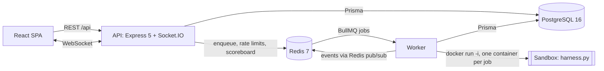

# Arbiter

An online judge with live programming contests: untrusted C++, Python, Java and JavaScript code runs in
a hardened, throwaway Docker container per submission, and the verdict streams to the browser test by
test.



More screens (light and dark themes, admin pages, plagiarism view, mobile) are in
[docs/screenshots](docs/screenshots).

## What it does

- **Practice**: 15 original problems with statements in Markdown and KaTeX, an in-browser Monaco
  editor with per-language templates and saved drafts, runs on custom input, and submissions judged
  against hidden tests.
- **Live judging**: Queued, Compiling, then one chip per test as each result arrives, then the verdict
  (AC, WA, TLE, MLE, RE, CE, OLE or IE) with time and memory. A failed sample shows input, expected and
  actual output.
- **Contests**: registration, countdowns corrected for the client's clock, a live ICPC scoreboard, and
  pairwise Elo ratings applied after the contest.
- **Profiles and leaderboard**: solved by difficulty, a 365-day activity heatmap, rating history and
  language breakdown.
- **Admin panel**: problem editor with live preview, bulk test upload, reference-solution validation,
  expected-output generation, contest editor, rating, a winnowing plagiarism check with a side-by-side
  view, a judge monitor (queues, workers, latency, throughput) and user roles.
- **Interfaces**: a REST API with an OpenAPI document and Swagger UI, Socket.IO events, Prometheus
  metrics, health and readiness endpoints.

## Engineering highlights

The parts most worth asking about, each with where to read more.

**Running hostile code safely.** Each job gets its own container: no network, read-only root file
system, small tmpfs mounts, memory and swap capped together, one CPU, at most 128 processes, all
capabilities dropped except the three the harness needs, `no-new-privileges`. Inside, a Python harness
runs the program as an unprivileged user with rlimits, caps stdout at 8 MB, kills the process group on a
wall timer and kills every leftover process after each test. The expected outputs never enter the
container: the worker compares outputs itself. 54 tests run against real Docker, including a fork bomb,
a 100 MB output flood, a network connect, writes to the harness, `kill -9 -1`, `/proc` reads of the
harness and a forged protocol line. The code review found one way around the limits (A-05: a child
process that its parent never waits for hid its memory and CPU use); the harness now acts as a child
subreaper and counts the whole process tree. Details: [docs/SANDBOX.md](docs/SANDBOX.md).

**Live results across processes.** The worker holds no client connections. It publishes events through
Redis (`@socket.io/redis-emitter`) and every API process relays them to its own clients
(`@socket.io/redis-adapter`), so API processes can be added without touching the worker. Socket events
are treated as hints: the client refetches over REST on reconnect and polls a pending submission, so a
lost event never leaves a spinner. The server closes a socket when its access token expires.

**Throughput, measured.** On a shared 4-core laptop with two judge slots, the judge handled about 43
submissions per minute (median of 3 runs: 43.7, range 40.1 to 45.9), and an unqueued submission took
2.65 s median from submit to verdict. With 4 and 8 users, throughput stayed flat and latency grew in
proportion, which points to the two slots as the bottleneck. Method and caveats:
[docs/BENCHMARKS.md](docs/BENCHMARKS.md).

**Failure handling.** Job ids are deterministic, so a double enqueue is deduplicated. A crashed job gets
3 attempts with backoff and the last one records FAILED/IE with a message. A 60 s reconciler ends rows
whose job was lost, and a janitor removes containers of dead workers (found by labels and Redis
heartbeats). A missing Docker CLI or image ends in a clear error, not a hang.

**Contest correctness under concurrency.** The scoreboard is a Redis sorted set (score = solved x 10^7 -
penalty) plus a hash of rows, rebuilt from Postgres when missing. Row writes are conditional (a Lua
script) and locked per user, so concurrent judging cannot leave a one-row or stale board. Rating runs in
one transaction under an advisory lock, refuses while submissions are still being judged, and freezes
the contest's times, penalty and problems afterwards.

**Sessions.** The access token lives only in memory (15 minutes); the refresh token is an httpOnly,
SameSite=Strict cookie scoped to `/api/auth`, rotated on every use, with reuse detection that revokes
the whole token family. Passwords use Argon2id; a login for an unknown account verifies a dummy hash, so
timing does not reveal which accounts exist. Admin rights are re-checked in the database on every
request, so a demotion applies at once.

**Plagiarism detection.** Winnowing as in MOSS: tokens are normalised (identifiers, numbers and strings
become placeholders), 8-token k-grams are hashed with 64-bit FNV-1a and a window of 4 selects the
fingerprints. The seed plants two copied pairs with renamed identifiers and the check finds both; the
seed's independent solutions score at most 0.53 against the 0.6 threshold.

## Architecture



1. The browser posts a submission. The API validates it, stores it as QUEUED, enqueues a BullMQ job
   and answers 202.
2. The worker takes the job, starts one sandbox container and drives the harness over JSON lines on
   stdin and stdout: compile, then one test at a time, samples first.
3. After each test the worker checks the output and publishes a progress event through Redis; the API
   pushes it to the browser over Socket.IO. Judging stops at the first failing test.
4. The worker stores the verdict, updates the contest scoreboard in Redis if needed and publishes the
   final events. The container is removed.

[docs/ARCHITECTURE.md](docs/ARCHITECTURE.md) has the request path, the submission sequence, the
realtime fan-out, the scoreboard and rating flow, and the design decisions with their reasons.
[docs/API.md](docs/API.md) covers the API conventions and endpoints.

## Tech stack

| Area | Choices |
| --- | --- |
| Language and tooling | TypeScript (strict, ESM), npm workspaces, Node 22, ESLint 9, Prettier 3 |
| API and worker | Express 5, Socket.IO 4 with the Redis adapter and emitter, Prisma 6, BullMQ 5, ioredis, zod 3, zod-to-openapi with Swagger UI, pino, helmet, express-rate-limit with a Redis store, jsonwebtoken, Argon2id (`@node-rs/argon2`), prom-client |
| Data | PostgreSQL 16, Redis 7 |
| Judge | Docker; a Debian bookworm image with g++ 12, Python 3.11, OpenJDK 17 and Node.js 18; a standard-library Python harness |
| Web | React 19, Vite 7, React Router 7, TanStack Query 5, Zustand 5, Tailwind CSS 4, Monaco (bundled, no CDN), react-markdown with KaTeX, Recharts |
| Tests | Vitest 3, Supertest, Testing Library, Playwright (Chromium) |
| Deployment | Docker Compose, nginx, optional Caddy for TLS, a GitHub Actions workflow |

## Quick start

Prerequisites: Node 22.12 or newer (with npm 10), Docker with Compose v2 (developed on Docker Desktop
for Windows), and Python 3.9 or newer for the test generator.

```sh
npm install
cp apps/api/.env.example apps/api/.env
cp apps/web/.env.example apps/web/.env
npm run infra:up        # Postgres on 55432 and Redis on 56379 (docker compose)
npm run db:deploy       # apply the Prisma migrations
npm run problems:gen    # generate the hidden tests (about 90 MB, not committed)
npm run db:seed         # load the seed data; wipes the application tables first
npm run sandbox:build   # build the judge image arbiter-sandbox:latest (about 1 GB)
npm run dev             # API on 4000, worker, web on 5173
```

Open `http://localhost:5173`. Swagger UI for the API is at `http://localhost:4000/api/docs`.

`npm run db:seed` stops with a message if the hidden tests are missing; run `npm run problems:gen`
first. Rerunning the seed gives the same data, with times relative to now. It contains 15 problems
(193 tests), 32 users, 3 contests (one ended and rated, one running until 14 days after seeding, one
upcoming) and about 1,100 historical submissions; [seed/problems/README.md](seed/problems/README.md)
describes the problem folders.

Seed accounts, for local development only (a production start refuses the default admin password):

| Username | Password | Role |
| --- | --- | --- |
| `demo` | `demo12345` | user; also the "Try the demo" button |
| `admin` | `admin12345` | admin |
| 30 synthetic users | same as `demo` | user |

[docs/DEMO.md](docs/DEMO.md) is a two-minute walk-through using this data.

## Running the tests

```sh
npm run typecheck && npm run lint && npm run format:check
npm test                # unit and integration tests; needs Postgres and Redis (npm run infra:up)
npm run test:sandbox    # real-Docker judge tests; needs the sandbox image, Postgres and Redis
npm run e2e             # Playwright; starts its own API, worker and web (database arbiter_e2e); needs the image
```

| Suite | Tests | Files |
| --- | ---: | ---: |
| API unit and integration (`npm test`) | 416 | 43 |
| Web unit and component (`npm test`) | 352 | 57 |
| Shared schemas (`npm test`) | 18 | 1 |
| Sandbox, real Docker (`npm run test:sandbox`) | 54 | 3 |
| End to end, Playwright (`npm run e2e`) | 15 | 4 |

Counted on 2026-11-12: the `npm test` and sandbox suites by running them (all passed), the e2e suite
with `playwright test --list` (its last full runs passed 15 of 15 in the review gate). The integration
tests use their own database (`arbiter_test`) and refuse to run against the development database.

## Project layout

```
apps/api/            Express API and judge worker (one codebase, two entry points)
  prisma/            schema, migrations, seed entry point
  src/modules/       auth, users, problems, submissions, runs, contests, plagiarism, admin, stats
  src/judge/         queue, processor, sandbox driver, checkers, verdicts, janitor, heartbeat
  src/realtime/      Socket.IO server, emitter, rooms
  test/sandbox/      real-Docker sandbox tests
apps/web/            React SPA (src/features, src/components, src/lib) and Playwright specs (e2e/)
packages/shared/     zod schemas, types and constants shared by the API and the web app
sandbox/             judge image (Dockerfile) and harness.py
seed/problems/       15 original problems: statements, generators, reference solutions
scripts/             test generator and verifier, judge-refs, load test, screenshots
deploy/              production Dockerfiles, nginx and Caddy configuration
docs/                design, architecture, API, sandbox, deployment, benchmarks, demo, review
```

## Security notes and trade-offs

- The judge's threat model, its defences and the tests behind them are in
  [docs/SANDBOX.md](docs/SANDBOX.md).
- The worker needs the host's Docker socket, which is root-equivalent on that host. Run it on a
  dedicated VM;
  [docs/DEPLOYMENT.md](docs/DEPLOYMENT.md#security-the-workers-docker-socket-is-root-equivalent)
  explains this and the gVisor option.
- Containers share the host kernel; a kernel exploit is out of scope for the default runtime.
- Every route validates its input with zod. JSON bodies are limited to 1 MB (20 MB for test uploads),
  source code and run input to 64 KB. Rate limits use Redis and answer 429 with `Retry-After`
  ([docs/API.md](docs/API.md#rate-limits)).
- Markdown renders without raw HTML, logs redact passwords, tokens, cookies and source code, and the
  production nginx sends a strict Content Security Policy (`script-src 'self'`).
- Accepted trade-off (review finding A-33): registration says when an email is already registered.
  That allows account enumeration, limited to 5 registration attempts per hour per IP. A generic
  "email or username taken" message would hide it, but without verification emails a person who already
  has an account would not learn that they should sign in instead. Login does not reveal whether an
  account exists.
- Known gaps: no end-to-end test of the admin contest flow (apply ratings, plagiarism run; A-70, covered
  by API and unit tests), and no per-IP cap on Socket.IO connections (part of A-11).

## Deployment

`docker-compose.prod.yml` runs Postgres, Redis, the API, the worker and nginx on one Linux VM, with
optional Caddy for TLS. [docs/DEPLOYMENT.md](docs/DEPLOYMENT.md) is the step-by-step guide, including
why serverless hosts cannot run the worker. The images and the compose stack were built and
smoke-tested on Docker Desktop; the guide's VM steps have not been run on a cloud VM.
`.github/workflows/ci.yml` defines four jobs (checks, integration, sandbox, e2e); it has not run on
GitHub, because nothing has been pushed.

## Benchmarks

From [docs/BENCHMARKS.md](docs/BENCHMARKS.md): one shared Windows laptop (i7-1195G7, 4 cores, Docker
Desktop on WSL2), production build, `JUDGE_CONCURRENCY=2`, medians of 3 runs. These are not capacity
claims for a server.

| Measurement | Result |
| --- | --- |
| Judged per minute with 2, 4 and 8 virtual users | 43.7, 42.8, 40.5 |
| Queue-to-verdict p50 / p95, 2 users (no waiting) | 2.65 s / 3.61 s |
| Queue-to-verdict p50 / p95, 8 users (waiting for a slot) | 11.25 s / 12.99 s |
| Read latency p50 at 1 client: problem list, scoreboard page of 50, landing stats | 6.5 ms, 9.1 ms, 3.8 ms |
| Container start on Docker Desktop, spawn to ready ([sandbox/README.md](sandbox/README.md)) | about 2.7 s |

## Code review record

[docs/review/2026-11-11-review.md](docs/review/2026-11-11-review.md) records a structured review of the
whole codebase through six lenses (sandbox, auth and API, contests, data, frontend, spec conformance):
85 raw findings, 70 after merging duplicates, 59 confirmed, 10 refuted and 1 rejected at triage. Of the
confirmed findings, 58 were fixed (3 of them partly) and 1 was skipped, each fix with a regression test.
Two adversarial rounds over the fixes found 17 and then 6 further issues, all fixed. One finding (A-33,
above) was left to the author's decision.
