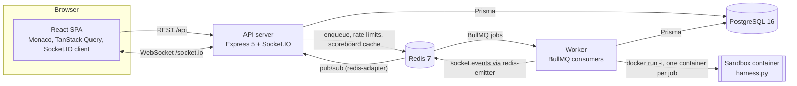
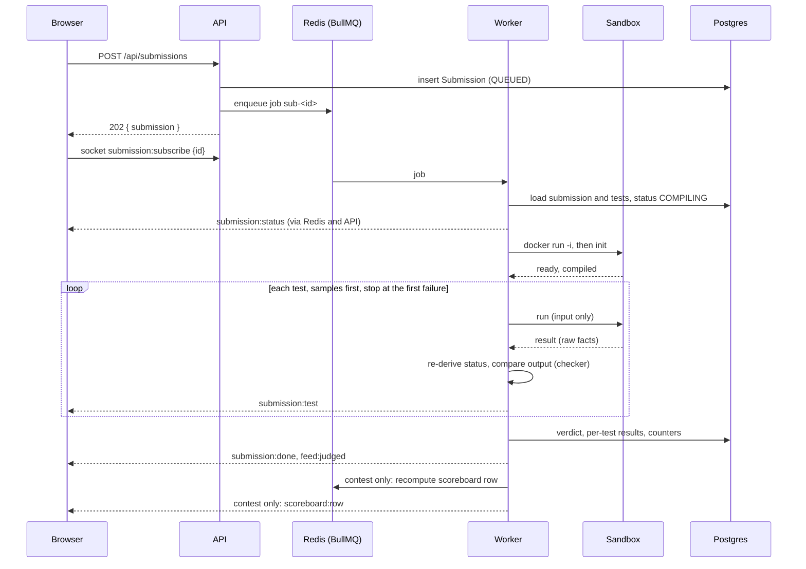
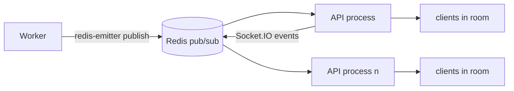
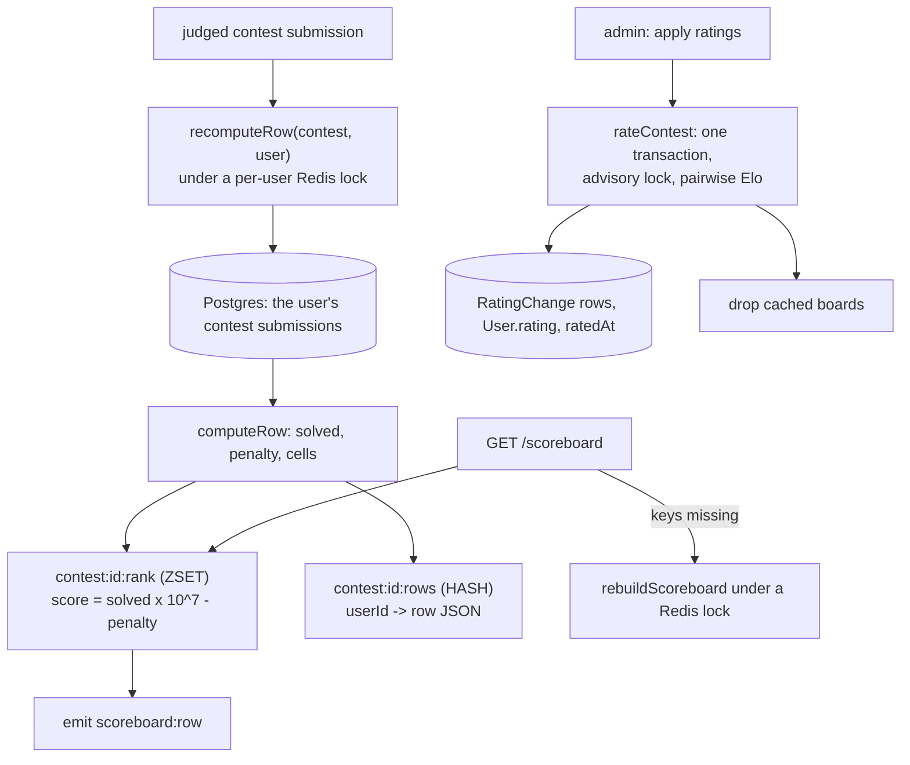

# Architecture

How the parts of Arbiter fit together and why they are built this way. The full specification is
[DESIGN.md](DESIGN.md); its Decisions log records every deviation and detail decided during the
build. The judge's security model has its own document: [SANDBOX.md](SANDBOX.md).

## Components

| Process | Entry point | Role |
| --- | --- | --- |
| `api` | `apps/api/src/index.ts` | REST API, Socket.IO server, OpenAPI document, `/healthz`, `/readyz`, `/metrics`. Stateless: every shared state is in Postgres or Redis. |
| `worker` | `apps/api/src/worker.ts` | BullMQ consumers for the queues `judge` (submissions, reference validation, output generation), `run` (custom input) and `plagiarism`; heartbeat, janitor, stuck-row reconciler, refresh-token purge; its own `/metrics`. |
| `web` | `apps/web` | Vite dev server in development; in production a static build served by nginx, which also proxies `/api` and `/socket.io`. |
| `shared` | `packages/shared` | zod schemas and types for every request, response and socket payload, plus constants (languages, limits, verdicts, rating tiers). Both the API and the SPA import it. |

The API and the worker share one codebase and one Docker image; they differ only in the entry
point. The worker is the only process that talks to Docker.

## Request path

```mermaid
flowchart LR
  B[Browser] --> N["nginx (prod) or Vite proxy (dev)"]
  N --> RQ[requestId, pino-http, metrics]
  RQ --> H[helmet, CORS, JSON body limit]
  H --> RL["rate limit (Redis store)"]
  RL --> AU["auth: optional, user or admin"]
  AU --> V["validate body, query, params (zod)"]
  V --> S[service: authorization + Prisma]
  S --> E["error handler: { error: { code, message, details } }"]
```

- Every route is declared through one helper (`lib/router.ts`) that applies auth, validation and
  OpenAPI registration in a single declaration. A test checks that every `/api` route is in the
  OpenAPI document and that the registered routes equal the specification's list plus two documented
  extras.
- Authorization lives in the services (owner-or-admin for source code, contest visibility rules), not
  only in middleware.
- An access token that claims ADMIN is re-checked against the database on every request, so a
  demotion takes effect at once (review findings A-01, A-R2-01).

## Submission lifecycle

1. The API validates the request, applies the 6 per minute per user limit, checks the contest rules,
   stores the submission as QUEUED and enqueues `sub-<submissionId>`. It answers 202 at once.
2. The worker loads the submission and its tests, sets COMPILING and starts one container.
3. Tests run in order, samples first. After each result the worker compares the output outside the
   sandbox and emits `submission:test`. Judging stops at the first failing test.
4. The worker stores the verdict (the first failing test's, or AC), the maximum CPU time and peak
   memory, per-test results and, for samples, the first 4 KB of stdout and the last 2 KB of stderr
   (so the UI can show input, expected and actual output).
5. The container exits and is removed (`--rm`).

Failure paths end in a visible state, never an endless spinner: a crashed job is retried (3 attempts,
exponential backoff), the last attempt records FAILED/IE, and a 60 s reconciler ends rows whose job
was lost. The browser also polls the submission while it is pending (every 8 s with the socket
connected, 2 s without), because socket events are hints and REST is the source of truth.

## Realtime fan-out

| Room | Joined by | Events |
| --- | --- | --- |
| `user:<id>` | every authenticated socket | `submission:done` (own), `run:result` |
| `submission:<id>` | `submission:subscribe` (owner or admin) | `submission:status`, `submission:test`, `submission:done` |
| `contest:<id>` | `contest:subscribe` (anyone, for a published contest; admins also for drafts) | `scoreboard:row` |
| `feed` | `feed:subscribe` (anyone) | `feed:judged` (practice submissions on published problems only) |

- The worker never holds client connections. It publishes through `@socket.io/redis-emitter`; every
  API process receives the event through `@socket.io/redis-adapter` and delivers it to its own
  clients in the room. More API processes can be added without changing the worker.
- The socket authenticates at the handshake with the access token. The server closes it when that
  token expires (guests are exempt) and the client reconnects with a fresh token (A-07).
- Each socket has a token bucket (20 burst, 10 per second); 25 rejected events disconnect it (A-11).
- Payloads are validated with the shared zod schemas on both sides.

## Scoreboard and rating

- **ICPC rules**: rank by problems solved, then by penalty (minutes to each first AC plus 20 minutes per
  earlier wrong attempt; CE and IE do not count). Ties share a rank.
- **Cache**: one ZSET for the order and one HASH for the rows per contest. A judged submission
  recomputes only that user's row from Postgres; a read of a missing cache rebuilds the whole board
  under a lock. Row writes are conditional on the cache existing (a Lua script), so a write can never
  leave a one-row board (A-04).
- **Rating**: pairwise Elo with K = 64, averaged over the N - 1 opponents. An admin applies it after
  the contest ends; it answers 409 while counted submissions are still being judged (A-03) or if the
  contest is already rated. The whole update is one transaction under an advisory lock (A-15), and a
  rated contest's times, penalty and problems are frozen (A-18).
- **Plagiarism**: winnowing as in MOSS (identifiers, numbers and strings normalised; 8-token k-grams;
  window 4; similarity = shared fingerprints / smaller set). The job runs on its own queue and yields
  to the event loop while comparing (A-19).

## Design decisions

| Decision | Reason |
| --- | --- |
| Docker CLI with an args array, not the Engine API | Portable across Docker Desktop and Linux, easy to reproduce by hand, and no shell is involved. |
| One container per job, not per test | A container start costs about 2.7 s on Docker Desktop; the harness kills every leftover process between tests instead. |
| Expected outputs stay in the worker | A submission cannot read answers it never receives. |
| The worker re-derives each status from raw facts | The classification rules live in one place the worker owns and are unit-tested without Docker; the harness's own status is kept only to log a mismatch. |
| BullMQ on Redis | Retries with backoff, deterministic job ids for deduplication, queue counts for the monitor, and Redis is already needed for rate limits, the scoreboard and Socket.IO. |
| Socket events as hints, REST as the truth | A lost socket or a missed event never leaves the UI stuck; the client refetches on reconnect and polls pending submissions. |
| Scoreboard in Redis, rebuilt from Postgres | Reads are one ZSET range; Postgres stays the only durable copy, so the cache can always be dropped. |
| Access token in memory, refresh token in an httpOnly SameSite=Strict cookie scoped to `/api/auth` | Script cannot read either token from storage, and the cookie is never sent cross-site, so there is no CSRF surface. Rotation with reuse detection limits a stolen refresh token. |
| zod schemas shared by API and SPA | One definition validates requests, types the client and generates the OpenAPI document. |
| Monaco, fonts and KaTeX bundled, no CDN | The production CSP can stay at `script-src 'self'`, and no third party sees the users' traffic. The auth, workspace and admin-editor e2e tests fail on any request to another origin. |
| Seed data from fixed random seeds | `npm run db:seed` gives the same data each time, with times relative to "now", so a reseed always yields a running contest (live for 14 days). |
