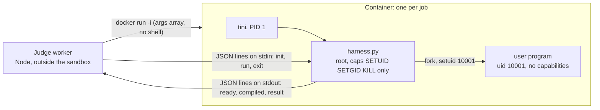

# The judge sandbox

Every submission is hostile code. This document describes what the judge assumes an attacker tries,
which mechanism stops each attempt, and which automated test proves it. The specification is
[DESIGN.md](DESIGN.md) section 8; the code is `apps/api/src/judge/` (worker side) and
`sandbox/harness.py` (inside the container).

## Threat model

Submitted code may try to:

- exhaust CPU time (an infinite loop) or wall time (`sleep`);
- exhaust memory, or exhaust process ids with a fork bomb;
- flood stdout or fill the disk;
- open network connections;
- read or write files outside its working directory, or read the expected outputs;
- kill or confuse the judge, or forge a result;
- leave processes running after its test ends;
- hide resource use in a child process that the parent never waits for.

Out of scope: kernel exploits that escape a container. Containers share the host kernel; the
optional gVisor runtime (`SANDBOX_RUNTIME=runsc`, see [DEPLOYMENT.md](DEPLOYMENT.md)) is the
answer to that, and it was not tested by the author.

## Layers



1. **Container** (one per job, started by `dockerRunArgs` in `apps/api/src/judge/sandbox.ts`).
2. **Harness** (`sandbox/harness.py`, Python standard library only): compiles and runs each test
   as an unprivileged user with resource limits.
3. **Worker**: owns the expected outputs, re-derives every status from raw facts, enforces an
   overall deadline, and cleans up containers.

## Container flags

```
docker run --rm -i --init --pull never
  --name arbiter-sbx-<jobId>-<rand6> --label arbiter.sandbox=1
  --label arbiter.prefix=<QUEUE_PREFIX> --label arbiter.worker=<workerId>
  --network none --read-only
  --tmpfs /work:rw,exec,nosuid,size=128m --tmpfs /tmp:rw,nosuid,size=32m
  --memory <M>m --memory-swap <M>m --cpus 1 --pids-limit 128
  --cap-drop ALL --cap-add SETUID --cap-add SETGID --cap-add KILL
  --security-opt no-new-privileges --ulimit core=0 --ulimit nofile=256:256
  [--runtime $SANDBOX_RUNTIME] arbiter-sandbox:latest
```

| Flag | What it stops |
| --- | --- |
| `--network none` | Any network access (only a loopback interface exists). |
| `--read-only`, two small tmpfs mounts | Writes to the image; the disk can fill only up to 128 MB (`/work`) and 32 MB (`/tmp`), in memory. |
| `--memory` = `--memory-swap` | Memory bombs: the cgroup limit `M` = problem limit + language overhead + 256 MB, capped at 2048 MB, with no swap. |
| `--cpus 1` | One job taking more than one CPU of the host. |
| `--pids-limit 128` | Fork bombs. |
| `--cap-drop ALL` plus three capabilities | The harness keeps only SETUID and SETGID (to drop to the `runner` user) and KILL (to kill runner processes). The program runs as uid 10001 and has no capabilities at all. |
| `--security-opt no-new-privileges` | Regaining privileges through setuid binaries. |
| `--init` | tini is PID 1 and reaps zombies; the program cannot signal PID 1. |
| `--pull never` | A missing image fails at once with "Sandbox image ... is not available" instead of contacting a registry. |
| labels | Let the janitor find containers of its own deployment (`arbiter.prefix`) and of dead workers (`arbiter.worker`). |

The worker passes the arguments as an array to the Docker CLI (`spawn`, never a shell string), so no
part of a submission reaches a command line.

## Harness limits

For every test the harness starts a fresh child (`start_new_session=True`). Before `exec`, the child:

- writes `1000` to `/proc/self/oom_score_adj`, so the cgroup OOM killer picks user code, never the
  harness;
- drops to uid/gid 10001 with no supplementary groups;
- sets `RLIMIT_CPU` = ceil(cpu limit / 1000) + 1 s, `RLIMIT_FSIZE` 16 MB, `RLIMIT_CORE` 0,
  `RLIMIT_NOFILE` 128, `RLIMIT_STACK` unlimited, and for C++ only `RLIMIT_AS` = memory limit + 64 MB.

While the test runs:

- stdout is read by a thread and capped at 8 MB; past the cap the process group is killed (OLE);
- stderr keeps only its last 2 KB;
- a wall-clock timer kills the process group at the wall limit (2 x CPU limit + 1 s);
- CPU time and peak memory come from `wait4` rusage, not from wall time.

After every test the harness kills every remaining `runner` process (it scans `/proc` and a
short-lived helper running as `runner` calls `kill(-1)`), including `setsid` and double-fork
escapes, so nothing survives into the next test.

The harness is a child subreaper (`prctl(PR_SET_CHILD_SUBREAPER)`): orphaned descendants are
re-parented to it, and their CPU time and peak memory count towards the test (review finding A-05).
A parent that forks a memory-hungry child and exits without waiting therefore still gets MLE.

Per-language CPU multipliers and memory overheads (C++ 1x, Python 3x, Java 2x, JavaScript 2x) are in
`apps/api/src/judge/languages.ts`.

## Protocol

The worker and the harness speak JSON lines; every byte payload is base64.

- worker to harness: `init` (source, compile and run commands, limits), `run` (one test input),
  `exit`;
- harness to worker: `ready` (with the harness pid), `compiled`, `result`, `error`.

Only the harness writes to the container's stdout; the program's stdout is a pipe that the harness
reads and wraps in base64. A program that prints a line that looks like `{"type":"result",...}` is
judged on that line as ordinary output and can never inject a protocol message.

A `result` carries raw facts (exit code, signal, CPU ms, peak RSS, `outputLimitExceeded`,
`wallKilled`). The worker re-derives the status from these facts with the same rules
(`judge/verdict.ts`: OLE, then MLE, then TLE, then RE, then OK) and treats its own classification as
authoritative; a mismatch is logged.

## What never enters the container

- **Expected outputs.** The worker sends only the input of each test and compares the program's
  output itself (`judge/checker.ts`). A unit test (`protocol.test.ts`: "init/run payloads never contain
  the expected output") guards this.
- Database credentials, Redis URLs, JWT secrets: the container gets no environment from the worker and
  no mounts.
- The Docker socket: only the worker process can start containers.

## Worker-side safety

- **Overall deadline**: 60 s to reach `ready`, then compile 20 s + the sum over tests of (wall limit +
  1 s) + 10 s, capped at 15 minutes (`containerDeadlineMs` in `judge/languages.ts`). Past it the
  worker runs `docker kill`.
- **Malformed harness output**, a missing Docker CLI or a missing image end the submission as
  FAILED with verdict IE and a clear `errorMessage` (admin-only), never an endless spinner.
- **Retries**: BullMQ gives a crashed job 3 attempts with exponential backoff; only the final attempt
  records FAILED/IE. Job ids are deterministic (`sub-<submissionId>`), so a double enqueue is
  deduplicated.
- **Lost jobs**: a `failed` handler and a 60 s reconciler end rows whose job vanished or stalled
  (review finding A-06).
- **Data retention**: custom-run jobs (source and input) are removed from Redis on completion and as
  soon as they fail for good (A-24, A-R2-07).

## Janitor

Every container carries `arbiter.sandbox=1`, its deployment's `arbiter.prefix` and the
`arbiter.worker` id. On start-up and every 60 s, the janitor (`judge/janitor.ts`) removes containers of
its own prefix that are either

- owned by a worker whose Redis heartbeat (`judge:worker:<id>`, 15 s TTL, refreshed every 5 s) is gone,
  re-checked once after one heartbeat interval so a short Redis gap never kills live work; or
- older than `READY_TIMEOUT_MS` + 15 min + 60 s, longer than any job's deadline (A-23).

Docker Desktop's VM clock was measured about 81 s ahead of the Windows host, so the age test errs
towards keeping containers.

## Tests that prove it

`npm run test:sandbox` runs against real Docker and the real image (no mocks of the sandbox):
54 tests in 3 files (`apps/api/test/sandbox/sandbox.test.ts`, `janitor.test.ts` and
`src/judge/processor.test.ts`).

| Attack or case | Expected result |
| --- | --- |
| Per language (C++, Python, Java, JavaScript): correct, wrong, syntax error, exception, infinite loop, 1 GB allocation | AC, WA, CE (with compiler output), RE, TLE, MLE |
| Fork bomb | RE or TLE within the deadline, no `arbiter-sbx-*` container left |
| Forking allocator whose child is never reaped; child still running when the parent exits | MLE (A-05) |
| Forking spinner whose child is never reaped | TLE (A-05) |
| `sleep 100` | TLE through the wall limit |
| 100 MB of output | OLE |
| Connect to 1.1.1.1:53 | fails |
| Write `/etc/x` or `/judge/harness.py` | fails |
| `kill -9 <harness pid>`; `kill -9 -1` from a forked child | first fails; second kills only runner processes; the next test still runs |
| Read `/proc/<harness pid>/fd/*` or `/proc/<harness pid>/environ` | permission denied |
| Print a fake `{"type":"result"...}` line | treated as program output |
| CRLF and BOM source, empty input and output | judged normally |
| Missing image, missing Docker CLI | clear SandboxError, FAILED/IE |
| Janitor | removes dead workers' containers, keeps live workers' and other prefixes' |

Unit tests cover the checkers (`checker.test.ts`, including "Unicode whitespace is not a separator",
A-48) and the verdict mapping (`verdict.test.ts`) without Docker.

## Review findings that tested the sandbox

The review of 2026-11-11 ([review record](review/2026-11-11-review.md)) had a dedicated sandbox lens.
Its confirmed findings in this area, all fixed with regression tests:

| Id | Finding | Fix |
| --- | --- | --- |
| A-05 | Memory and CPU limits could be evaded through an unwaited child | harness became a child subreaper and counts reaped descendants |
| A-06 | Rows stuck forever after lost jobs | `failed` handler and 60 s reconciler |
| A-23 | Janitor age cap shorter than the session deadline | cap raised above the deadline |
| A-24, A-R2-07 | Queue retention kept run source and input in Redis | per-queue retention; run jobs dropped on completion and final failure |
| A-45 | Enqueue failure left orphan QUEUED rows | row marked FAILED, 5 s enqueue timeout |
| A-48 | Checkers split tokens on Unicode whitespace | ASCII whitespace only |
| A-31 | Landing page claimed "no Linux capabilities" | the card now lists the real `--cap-add` flags |

## Known limits

- Containers share the host kernel. With the default `runc` runtime a kernel exploit escapes the
  sandbox; gVisor (`runsc`) narrows that, and is untested here.
- The worker mounts the host's Docker socket, which is root-equivalent on that host: run it on a
  dedicated VM ([DEPLOYMENT.md](DEPLOYMENT.md#security-the-workers-docker-socket-is-root-equivalent)).
- Container start costs about 2.7 s on Docker Desktop (median of 5 per language, measured 2026-11-08,
  [sandbox/README.md](../sandbox/README.md)); one container per test would multiply that, so one
  container serves all tests of a job and the harness cleans up between tests instead.
